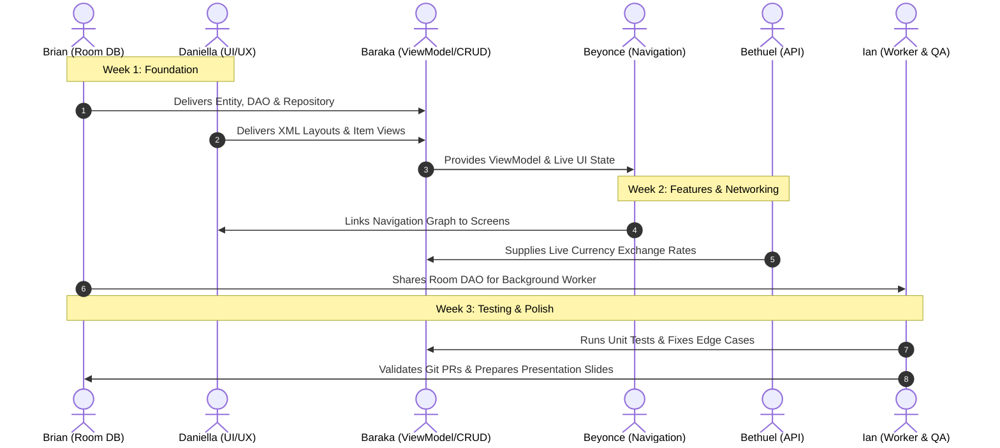

# Group 5: Team Responsibility Delegation
**Course**: BBIT Year 3.2 Mobile Application Development (Aug–Dec 2026)  
**Project**: CAT 2 — Android Mobile Application Development  
**Application Title**: Track (Real Estate & Rental Property Listing System)  
**Total Marks**: 30 Marks | **Timeline**: < 3 Weeks (21 Days)

---

## 1. Verified Team Roster & Collaborators

The following 6 members comprise **Group 5**:

| No. | Full Name | GitHub Handle | Assigned Engineering Role |
| :---: | :--- | :--- | :--- |
| 1 | **Brian Koech** *(You)* | `fabn3ez` | **Team Lead & Data Layer Architect (Room DB & Repo)** |
| 2 | **Daniella Wanjohi** | `Daniwanjohi` | **UI/UX & Dynamic Lists Specialist (RecyclerView & Views)** |
| 3 | **Onserio Baraka Osumo** | `Default404` | **Business Logic, CRUD & Validation Lead (ViewModels & State)** |
| 4 | **Kamure Beyonce Kabura** | `Kamure Beyoncé Kabura` | **Navigation & Screen Flow Specialist (Jetpack Nav & Details)** |
| 5 | **Bethuel Kilonzo** | `Kavate1` | **API & Remote Data Engineer (Retrofit & Currency API)** |
| 6 | **Ian Simiyu** | Group Member | **Background Processing, QA Testing & Git QA (WorkManager & Tests)** |

---

## 2. Rubric Marks Distribution Across Members

Every member has primary ownership of specific rubric criteria. During the technical defense, the lecturer evaluates both the collective application and **individual mastery**:

```
┌───────────────────────────────────────┬─────────┬─────────────────────────────────┐
│ Rubric Component                      │  Marks  │ Primary Responsible Member      │
├───────────────────────────────────────┼─────────┼─────────────────────────────────┤
│ Problem Relevance & Concept Note      │ 4 Marks │ Whole Group (Brian Koech lead)  │
│ UI/UX & Android Interface             │ 4 Marks │ Daniella Wanjohi                │
│ CRUD Functionality                    │ 4 Marks │ Onserio Baraka Osumo            │
│ Data Persistence / Room Database      │ 4 Marks │ Brian Koech                     │
│ Android Architecture (MVVM)           │ 4 Marks │ Brian Koech & Onserio Baraka    │
│ Navigation & Application Functionality│ 2 Marks │ Kamure Beyonce Kabura           │
│ API Integration                       │ 1 Mark  │ Bethuel Kilonzo                 │
│ Background Processing (WorkManager)   │ 1 Mark  │ Ian Simiyu                      │
│ Testing, Validation & Error Handling  │ 2 Marks │ Ian Simiyu & Onserio Baraka     │
│ GitHub Collaboration                  │ 2 Marks │ Whole Group (Ian Simiyu QA)     │
│ Presentation & Technical Defence      │ 2 Marks │ Whole Group (Individual Viva)   │
├───────────────────────────────────────┼─────────┼─────────────────────────────────┤
│ TOTAL MARKS                           │ 30 Mks  │ Target: 30 / 30                 │
└───────────────────────────────────────┴─────────┴─────────────────────────────────┘
```

---

## 3. Individual Member Dossiers (Tasks, Deliverables & Defense Prep)

---

### Member 1: Brian Koech
* **Role**: **Team Lead & Data Layer Architect**
* **Git Branch**: `feature/database-room-brian`
* **Target Marks**: Data Persistence (4 Marks) + Architecture Co-lead (2 Marks)

#### Responsibilities & Deliverables:
1. **Room Entities**:
   - `PropertyEntity`: Fields matching the concept note: `id` (Long, PK autoGenerate), `title` (String), `address` (String), `propertyType` (String: House/Apartment/Commercial), `monthlyPrice` (Double), `bedrooms` (Int), `isAvailable` (Boolean), `agentPhone` (String), `description` (String), `createdAt` (Long).
2. **Room DAO (`PropertyDao`)**:
   - `@Insert(onConflict = OnConflictStrategy.REPLACE) suspend fun insertProperty(property: PropertyEntity): Long`
   - `@Update suspend fun updateProperty(property: PropertyEntity)`
   - `@Delete suspend fun deleteProperty(property: PropertyEntity)`
   - `@Query("SELECT * FROM properties ORDER BY createdAt DESC") fun getAllProperties(): Flow<List<PropertyEntity>>`
   - `@Query("SELECT * FROM properties WHERE isAvailable = 1") fun getAvailableProperties(): Flow<List<PropertyEntity>>`
   - `@Query("SELECT * FROM properties WHERE id = :id") suspend fun getPropertyById(id: Long): PropertyEntity?`
3. **Database Configuration (`AppDatabase`)**:
   - Abstract class extending `RoomDatabase`, singleton instance using `Room.databaseBuilder`.
4. **Repository Layer (`PropertyRepository`)**:
   - Coordinates between local DAO and remote data source, providing clean Flow/suspend methods for ViewModels.

#### Sample Git Commits:
- `feat(database): define PropertyEntity with room annotations`
- `feat(dao): implement PropertyDao with CRUD queries and Flow streams`
- `feat(repository): implement PropertyRepository pattern isolating Room DB`

#### Oral Viva Defense Preparation:
* **Lecturer Question**: *"Why did you use Room instead of standard SQLiteOpenHelper?"*
  * **Brian's Answer**: *"Room provides compile-time verification of SQL queries so syntax errors fail at compile time rather than crashing at runtime. It eliminates boilerplate conversion between SQLite Cursor and data objects, and natively returns Kotlin Coroutine Flow objects so the UI updates automatically whenever the database changes."*
* **Lecturer Question**: *"What happens under the hood when data is inserted?"*
  * **Brian's Answer**: *"The repository calls DAO's suspend insert function on Dispatchers.IO. Room opens an SQLite transaction, executes the INSERT statement, notifies active Flow observers of the change, and closes the transaction."*

---

### Member 2: Daniella Wanjohi
* **Role**: **UI/UX & Dynamic Lists Specialist**
* **Git Branch**: `feature/ui-views-daniella`
* **Target Marks**: UI/UX & Android Interface (4 Marks)

#### Responsibilities & Deliverables:
1. **Screen Layouts**:
   - `fragment_dashboard.xml`: Summary metric cards (Total, Available, Booked), horizontal quick-filter chips, "Recommended" card view.
   - `fragment_property_list.xml`: Search `SearchView`/`EditText`, interactive chips for price brackets (Budget <15k, Mid 15k-30k, Premium 30k-65k, Luxury >65k), and `RecyclerView`.
   - `item_property_card.xml`: CardView layout displaying property image thumbnail, title, address pin, price badge (`KES 25,000/mo`), bedroom count icon, and dynamic Availability badge (`Available` in green, `Booked` in grey).
2. **Dynamic List Adapter**:
   - `PropertyListAdapter` extending `ListAdapter<PropertyEntity, PropertyViewHolder>` using `DiffUtil.ItemCallback` for efficient animations without redrawing the entire list.
3. **UX Polish States**:
   - Empty State view layout: Friendly icon + text *"No properties found in this price bracket"*.
   - Loading State: Shimmer or `ProgressBar` while reading database.

#### Sample Git Commits:
- `feat(ui): design dashboard summary cards and Material 3 theme`
- `feat(ui): create item_property_card layout with price and status badges`
- `feat(adapter): implement PropertyListAdapter with DiffUtil item callback`

#### Oral Viva Defense Preparation:
* **Lecturer Question**: *"Why did you use ListAdapter with DiffUtil instead of a standard RecyclerView.Adapter with notifyDataSetChanged()?"*
  * **Daniella's Answer**: *"notifyDataSetChanged() redraws every single item on the screen, causing lag and losing scroll position. ListAdapter with DiffUtil calculates the exact diff between the old and new lists on a background thread and only updates the specific cards that changed, providing 60fps smooth animations."*
* **Lecturer Question**: *"How does your UI handle empty states and error states?"*
  * **Daniella's Answer**: *"We designed an empty state container in the layout. When the Flow emits an empty list, the adapter toggles visibility: hiding the RecyclerView and displaying the empty view with a helpful call-to-action."*

---

### Member 3: Onserio Baraka Osumo
* **Role**: **Business Logic, CRUD & Form Validation Lead**
* **Git Branch**: `feature/crud-viewmodel-baraka`
* **Target Marks**: CRUD Functionality (4 Marks) + Validation (1 Mark)

#### Responsibilities & Deliverables:
1. **PropertyViewModel**:
   - Exposes `uiState: StateFlow<PropertyUiState>` to the UI.
   - Holds search query, selected property type filter, and selected price category filter.
2. **Full CRUD Implementation**:
   - **Create**: Collect form inputs, validate, insert via repository.
   - **Read**: Expose filtered properties combining search query and Room Flow.
   - **Update**: Edit existing property details and instant toggle `markAsBooked(propertyId)`.
   - **Delete**: Remove listing with confirmation dialog and undo Snackbar.
3. **Form Input Validation**:
   - `PropertyValidator`: Checks that title/address are not blank, price is a positive number, bedrooms $> 0$, and phone number matches Kenyan telecom formats (`^(?:254|\+254|0)?(7(?:(?:[129][0-9])|(?:0[0-8])|(?:4[0-35-68])|(?:5[7-9])|(?:6[8-9]))[0-9]{6})$`).
4. **Smart Recommendation & Price Categorization**:
   - Ports the console `when` expression directly into a Kotlin domain helper:
     ```kotlin
     fun getRecommendation(price: Double, isAvailable: Boolean): String = when {
         isAvailable && price < 30000 -> "⭐ Recommended: Available and affordable!"
         isAvailable && price >= 30000 -> "Available (Premium)"
         !isAvailable -> "Currently Booked"
         else -> "Check Details"
     }
     ```

#### Sample Git Commits:
- `feat(viewmodel): setup PropertyViewModel with StateFlow state container`
- `feat(validation): implement PropertyValidator with regex for phone and price bounds`
- `feat(crud): implement full create, update, and delete actions with confirmation dialogs`

#### Oral Viva Defense Preparation:
* **Lecturer Question**: *"Why is ViewModel used instead of doing logic directly inside the Activity or Fragment?"*
  * **Onserio's Answer**: *"Activities and Fragments are destroyed and recreated during configuration changes like screen rotations. ViewModel survives configuration changes, preventing data loss, avoiding redundant database calls, and maintaining the exact user state."*
* **Lecturer Question**: *"What happens when a user submits an invalid price or empty address?"*
  * **Onserio's Answer**: *"The PropertyValidator intercepts the submission before reaching the database, returning a ValidationError. The ViewModel emits this state, setting error text on the TextInputLayouts and disabling the submit button until valid."*

---

### Member 4: Kamure Beyonce Kabura
* **Role**: **Navigation & Screen Flow Specialist**
* **Git Branch**: `feature/navigation-details-beyonce`
* **Target Marks**: Navigation & Application Functionality (2 Marks)

#### Responsibilities & Deliverables:
1. **Jetpack Navigation Graph (`nav_graph.xml`)**:
   - Define destinations: `DashboardFragment`, `PropertyListFragment`, `PropertyDetailFragment`, `AddEditPropertyFragment`.
   - Setup actions with animations and SafeArgs arguments (passing `propertyId: Long` to Detail and Edit screens).
2. **Property Details Screen**:
   - Displays complete information: address, rent, bedrooms, description, availability tag.
   - Solves the concept note problem (*"no easy way of receiving requests for viewings"*) by providing direct intent buttons:
     - **"Call Agent"**: Triggers `Intent.ACTION_DIAL` with agent's phone.
     - **"Book Viewing via SMS/WhatsApp"**: Pre-fills an inquiry message (*"Hi, I am interested in viewing property #{id} at {address}"*).
3. **Safe Navigation & Backstack**:
   - Handles the Up/Back button properly so navigating back from Edit goes to Details, and deleting pops back to List.

#### Sample Git Commits:
- `feat(navigation): create nav_graph.xml with SafeArgs arguments`
- `feat(details): build PropertyDetailFragment with viewing inquiry intent actions`
- `feat(navigation): configure bottom navigation and backstack popUpTo behaviors`

#### Oral Viva Defense Preparation:
* **Lecturer Question**: *"How does your app pass data between the property list and the details screen?"*
  * **Beyonce's Answer**: *"We use Jetpack Navigation Component with SafeArgs. When a user clicks a property card, the navigation action passes the `propertyId` as a type-safe argument. The `PropertyDetailFragment` retrieves it via `navArgs()`, ensuring zero runtime ClassCastExceptions."*
* **Lecturer Question**: *"How does your application integrate with other Android system apps?"*
  * **Beyonce's Answer**: *"On the Property Details screen, clicking 'Call Agent' or 'Request Viewing' fires an implicit Android Intent (ACTION_DIAL or ACTION_SENDTO). This delegates communication to the device's default phone or SMS application without violating privacy."*

---

### Member 5: Bethuel Kilonzo
* **Role**: **API & Remote Data Engineer**
* **Git Branch**: `feature/api-retrofit-bethuel`
* **Target Marks**: API Integration (1 Mark) + Architecture Data Flow (1 Mark)

#### Responsibilities & Deliverables:
1. **Retrofit 2 Setup**:
   - `RetrofitClient`: Configured with base URL, `GsonConverterFactory`, and `OkHttpClient` with logging interceptor.
2. **Public API Service (`ExchangeRateApi`)**:
   - Meaningful use case: Many diaspora Kenyans and expatriates rent houses priced in KES but budgeted in USD or EUR.
   - Calls a public API (e.g., `https://open.er-api.com/v6/latest/KES` or Frankfurter API) to fetch real-time conversion rates.
3. **Remote Data Source & Error Handling**:
   - Implements `suspend fun getExchangeRates(): Result<ExchangeRatesResponse>`.
   - Graceful offline fallback: If the phone is offline or API fails, catches `IOException`/`HttpException`, uses cached exchange rates, and displays a Snackbar: *"Showing offline estimated currency rates"*.
4. **Displaying Converted Rent**:
   - On `PropertyDetailFragment`, shows: `KES 45,000 (~ $348.80 USD | €321.40 EUR)`.

#### Sample Git Commits:
- `feat(network): setup Retrofit client and OkHttp logging interceptor`
- `feat(api): implement currency exchange rate service for multi-currency rent`
- `feat(network): add offline error handling and cached rate fallback`

#### Oral Viva Defense Preparation:
* **Lecturer Question**: *"How does Retrofit work with Kotlin Coroutines?"*
  * **Bethuel's Answer**: *"Retrofit natively supports Kotlin Coroutines. By declaring interface methods with the `suspend` keyword, Retrofit runs HTTP calls asynchronously without blocking the Main UI thread, resuming execution when the response arrives."*
* **Lecturer Question**: *"What happens when the API is down or there is no internet connection?"*
  * **Bethuel's Answer**: *"We wrap the network call in a `runCatching` block. When an `UnknownHostException` or `SocketTimeoutException` occurs, we catch it, emit a cached exchange rate, and notify the UI to show an offline indicator so the app never crashes."*

---

### Member 6: Ian Simiyu
* **Role**: **Background Processing, QA Testing & Git QA**
* **Git Branch**: `feature/workmanager-testing-ian`
* **Target Marks**: Background Processing (1 Mark) + Testing (1 Mark) + GitHub Collaboration (2 Marks)

#### Responsibilities & Deliverables:
1. **WorkManager Background Processing**:
   - `ListingAuditWorker`: Extends `CoroutineWorker`. Periodically runs every 24 hours (or triggers on demand for demo).
   - Checks properties in Room DB: If any property has been marked "Available" for more than 14 days, fires a local push notification reminding the agent to update availability or review pricing.
   - Builds `NotificationCompat` with high-priority Android Notification Channel (`"property_alerts"`).
   - Sets constraints: `Constraints.Builder().setRequiresBatteryNotLow(true).build()`.
2. **Unit Testing**:
   - Writes unit tests using `JUnit4` and Google `Truth` / Kotlin `assertEquals`:
     - `PropertyDaoTest`: Uses in-memory Room database (`Room.inMemoryDatabaseBuilder`) to test Insert, Update, and Delete operations.
     - `PropertyValidatorTest`: Tests invalid email, invalid phone number, negative price inputs.
3. **Repository QA & Presentation**:
   - Coordinates Git PR merges, ensuring every member has clean pull requests.
   - Prepares the 5-part slide deck required for the final CAT 2 presentation.

#### Sample Git Commits:
- `feat(workmanager): implement ListingAuditWorker and notification channel`
- `test(database): add Room DAO unit tests with in-memory database`
- `docs(readme): add project architecture diagram, setup instructions, and team roster`

#### Oral Viva Defense Preparation:
* **Lecturer Question**: *"Why did you use WorkManager instead of a Foreground Service or AlarmManager?"*
  * **Ian's Answer**: *"WorkManager is Google's recommended solution for persistent, deferrable background work. Unlike AlarmManager or Services, WorkManager respects Android battery optimizations (Doze mode), guarantees execution even if the app process is killed or the device reboots, and adheres to constraints like battery level."*
* **Lecturer Question**: *"How did you test your Room database without affecting real user data?"*
  * **Ian's Answer**: *"We wrote JUnit tests using `Room.inMemoryDatabaseBuilder()`. An in-memory database runs in RAM and is completely destroyed when the test finishes, ensuring isolated, repeatable unit tests that do not write to phone disk."*

---

## 4. Cross-Functional Dependencies & Handoff Schedule



---

## 5. GitHub Collaboration Protocol (Guaranteeing 2/2 Marks)

The CAT 2 guidelines state:
> *"The repository should demonstrate genuine development activity... Simply uploading the complete project shortly before submission will not be considered sufficient."*

### Mandatory Rules for All 6 Members:
1. **Never commit directly to `main`**: Everyone works on their designated feature branch.
2. **Branch Names**:
   - `feature/database-room-brian`
   - `feature/ui-views-daniella`
   - `feature/crud-viewmodel-baraka`
   - `feature/navigation-details-beyonce`
   - `feature/api-retrofit-bethuel`
   - `feature/workmanager-testing-ian`
3. **Pull Request Protocol**:
   - When your feature is working, open a PR into `main`.
   - Every PR requires **at least 1 peer approval** before merging.
4. **Commit Frequency**:
   - Make small, meaningful commits as you code (aim for 4–8 commits per person over the 3 weeks).
