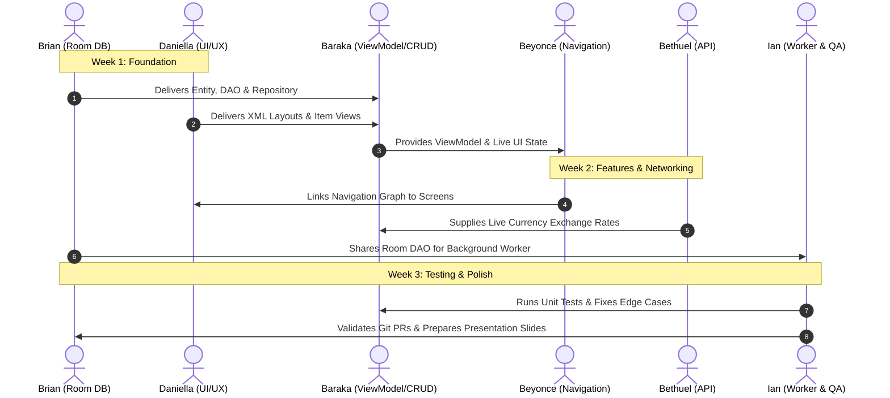

# Group 5: Team Responsibility Delegation
**Course**: BBIT Year 3.2 Mobile Application Development (Aug–Dec 2026)  
**Project**: CAT 2 — Android Mobile Application Development  
**Application Title**: Track (Real Estate & Rental Property Listing System)  
**Total Marks**: 30 Marks | **Timeline**: < 3 Weeks (21 Days)

---

## 1. Verified Team Roster & Collaborators

The following 6 members comprise **Group 5**:

| No. | Full Name | GitHub Handle | Assigned Engineering Role |
| :---: | :--- | :--- | :--- |
| 1 | **Brian Koech** | `fabn3ez` | **Team Lead & Data Layer Architect (Room DB & Repo)** |
| 2 | **Daniella Wanjohi** | `Daniwanjohi` | **UI/UX & Dynamic Lists Specialist (RecyclerView & Views)** |
| 3 | **Onserio Baraka Osumo** | `Default404` | **Business Logic, CRUD & Validation Lead (ViewModels & State)** |
| 4 | **Kamure Beyonce Kabura** | `Kamure Beyoncé Kabura` | **Navigation & Screen Flow Specialist (Jetpack Nav & Details)** |
| 5 | **Bethuel Kilonzo** | `Kavate1` | **API & Remote Data Engineer (Retrofit & Currency API)** |
| 6 | **Ian Simiyu** | Group Member | **Background Processing, QA Testing & Git QA (WorkManager & Tests)** |

---

## 2. Rubric Marks Distribution Across Members

Every member has primary ownership of specific rubric criteria:

```
┌───────────────────────────────────────┬─────────┬─────────────────────────────────┐
│ Rubric Component                      │  Marks  │ Primary Responsible Member      │
├───────────────────────────────────────┼─────────┼─────────────────────────────────┤
│ Problem Relevance & Concept Note      │ 4 Marks │ Whole Group (Brian Koech lead)  │
│ UI/UX & Android Interface             │ 4 Marks │ Daniella Wanjohi                │
│ CRUD Functionality                    │ 4 Marks │ Onserio Baraka Osumo            │
│ Data Persistence / Room Database      │ 4 Marks │ Brian Koech                     │
│ Android Architecture (MVVM)           │ 4 Marks │ Brian Koech & Onserio Baraka    │
│ Navigation & Application Functionality│ 2 Marks │ Kamure Beyonce Kabura           │
│ API Integration                       │ 1 Mark  │ Bethuel Kilonzo                 │
│ Background Processing (WorkManager)   │ 1 Mark  │ Ian Simiyu                      │
│ Testing, Validation & Error Handling  │ 2 Marks │ Ian Simiyu & Onserio Baraka     │
│ GitHub Collaboration                  │ 2 Marks │ Whole Group (Ian Simiyu QA)     │
│ Presentation & Technical Defence      │ 2 Marks │ Whole Group                     │
├───────────────────────────────────────┼─────────┼─────────────────────────────────┤
│ TOTAL MARKS                           │ 30 Mks  │ Target: 30 / 30                 │
└───────────────────────────────────────┴─────────┴─────────────────────────────────┘
```

---

## 3. Individual Member Task Allocation & Deliverables

---

### Member 1: Brian Koech
* **Role**: **Team Lead & Data Layer Architect**
* **Git Branch**: `feature/database-room-brian`
* **Target Marks**: Data Persistence (4 Marks) + Architecture Co-lead (2 Marks)

#### Responsibilities & Deliverables:
1. **Room Entities**:
   - `PropertyEntity`: Fields matching the concept note: `id` (Long, PK autoGenerate), `title` (String), `address` (String), `propertyType` (String: House/Apartment/Commercial), `monthlyPrice` (Double), `bedrooms` (Int), `isAvailable` (Boolean), `agentPhone` (String), `description` (String), `createdAt` (Long).
2. **Room DAO (`PropertyDao`)**:
   - `insertProperty(property: PropertyEntity): Long`
   - `updateProperty(property: PropertyEntity)`
   - `deleteProperty(property: PropertyEntity)`
   - `getAllProperties(): Flow<List<PropertyEntity>>`
   - `getAvailableProperties(): Flow<List<PropertyEntity>>`
   - `getPropertyById(id: Long): PropertyEntity?`
3. **Database Configuration (`AppDatabase`)**:
   - Abstract class extending `RoomDatabase`, singleton instance using `Room.databaseBuilder`.
4. **Repository Layer (`PropertyRepository`)**:
   - Coordinates between local DAO and data sources, providing Flow and suspend methods for ViewModels.

---

### Member 2: Daniella Wanjohi
* **Role**: **UI/UX & Dynamic Lists Specialist**
* **Git Branch**: `feature/ui-views-daniella`
* **Target Marks**: UI/UX & Android Interface (4 Marks)

#### Responsibilities & Deliverables:
1. **Screen Layouts**:
   - `fragment_dashboard.xml`: Summary metric cards (Total, Available, Booked), quick filter chips, and recommended card view.
   - `fragment_property_list.xml`: Search bar, filter chips for price brackets, and RecyclerView.
   - `item_property_card.xml`: CardView layout displaying property image thumbnail, title, address pin, price badge, bedroom count icon, and availability badge.
2. **Dynamic List Adapter**:
   - `PropertyListAdapter` extending `ListAdapter<PropertyEntity, PropertyViewHolder>` using `DiffUtil.ItemCallback` for smooth updates.
3. **UX States**:
   - Empty state view when no properties match filters.
   - Loading indicator while reading database.

---

### Member 3: Onserio Baraka Osumo
* **Role**: **Business Logic, CRUD & Form Validation Lead**
* **Git Branch**: `feature/crud-viewmodel-baraka`
* **Target Marks**: CRUD Functionality (4 Marks) + Validation (1 Mark)

#### Responsibilities & Deliverables:
1. **PropertyViewModel**:
   - Exposes `uiState: StateFlow<PropertyUiState>` to the UI.
   - Holds search query, selected property type filter, and selected price category filter.
2. **Full CRUD Implementation**:
   - **Create**: Collect form inputs, validate, and insert via repository.
   - **Read**: Expose filtered properties combining search query and Room Flow.
   - **Update**: Edit existing property details and instant toggle `markAsBooked(propertyId)`.
   - **Delete**: Remove listing with confirmation dialog and undo Snackbar.
3. **Form Input Validation**:
   - `PropertyValidator`: Checks title/address non-blank, valid price bounds, bedroom count, and Kenyan phone number format.
4. **Smart Recommendation & Price Categorization**:
   - Domain helpers for price categories and recommendation tags.

---

### Member 4: Kamure Beyonce Kabura
* **Role**: **Navigation & Screen Flow Specialist**
* **Git Branch**: `feature/navigation-details-beyonce`
* **Target Marks**: Navigation & Application Functionality (2 Marks)

#### Responsibilities & Deliverables:
1. **Jetpack Navigation Graph (`nav_graph.xml`)**:
   - Destinations: `DashboardFragment`, `PropertyListFragment`, `PropertyDetailFragment`, `AddEditPropertyFragment`.
   - Actions with transitions and SafeArgs arguments (`propertyId: Long`).
2. **Property Details Screen**:
   - Displays full information: address, rent, bedrooms, description, and status tag.
   - Direct viewing inquiry actions:
     - "Call Agent" via dialer intent.
     - "Book Viewing" via SMS/messaging intent with pre-filled inquiry text.
3. **Navigation & Backstack**:
   - Proper Up/Back handling and stack cleanup on delete/edit.

---

### Member 5: Bethuel Kilonzo
* **Role**: **API & Remote Data Engineer**
* **Git Branch**: `feature/api-retrofit-bethuel`
* **Target Marks**: API Integration (1 Mark) + Architecture Data Flow (1 Mark)

#### Responsibilities & Deliverables:
1. **Retrofit Setup**:
   - `RetrofitClient`: Configured with base URL, converter factory, and logging interceptor.
2. **Exchange Rate API Service**:
   - Public API integration to fetch currency conversion rates (e.g., KES to USD/EUR).
3. **Data Source & Error Handling**:
   - Graceful fallback: handles offline state with cached rates.
4. **Converted Rent Display**:
   - Displays estimated converted price on the property details screen.

---

### Member 6: Ian Simiyu
* **Role**: **Background Processing, QA Testing & Git QA**
* **Git Branch**: `feature/workmanager-testing-ian`
* **Target Marks**: Background Processing (1 Mark) + Testing (1 Mark) + GitHub Collaboration (2 Marks)

#### Responsibilities & Deliverables:
1. **WorkManager Background Processing**:
   - `ListingAuditWorker`: Periodically checks property availability status.
   - Notification builder with Android notification channel for alerts.
   - Work constraints (battery and network state).
2. **Unit Testing**:
   - `PropertyDaoTest`: Tests DAO CRUD queries using an in-memory database.
   - `PropertyValidatorTest`: Tests form input validations.
3. **Repository QA & Presentation**:
   - Coordinates Git PR merges and helps compile final presentation materials.

---

## 4. Cross-Functional Dependencies & Handoff Schedule



---

## 5. GitHub Collaboration Protocol

The CAT 2 guidelines require demonstrated collaborative development:

### Workflow Rules:
1. **Feature Branches**: Everyone works on their designated feature branch:
   - `feature/database-room-brian`
   - `feature/ui-views-daniella`
   - `feature/crud-viewmodel-baraka`
   - `feature/navigation-details-beyonce`
   - `feature/api-retrofit-bethuel`
   - `feature/workmanager-testing-ian`
2. **Pull Requests**:
   - Open a PR into `main` when a feature branch is ready.
   - Have at least 1 team member review and approve before merging.
3. **Commit Practice**:
   - Make small, meaningful commits as you implement each part.
